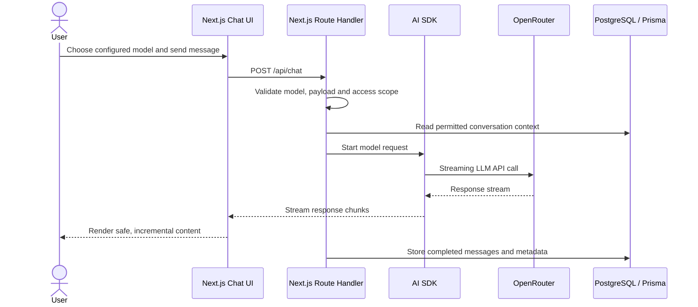
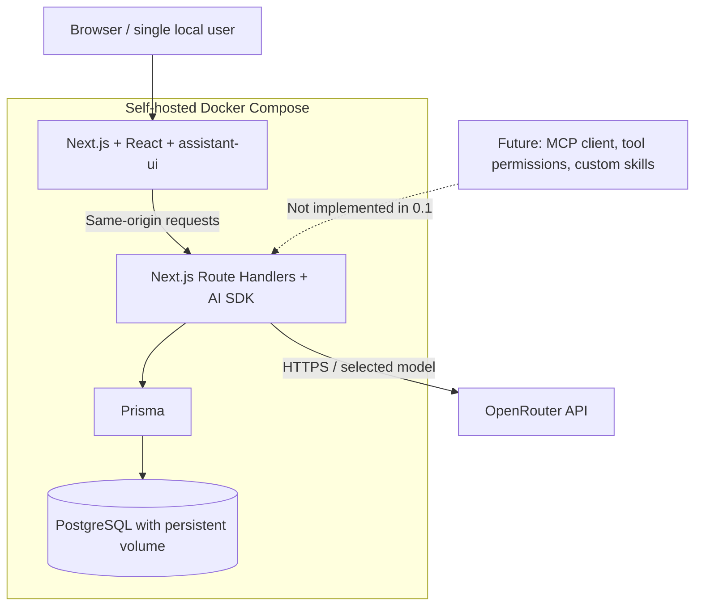

# OpenNook AI

> **A self-hosted, extensible AI assistant — starting with a simple, capable chat.**

[](LICENSE)


**OpenNook AI** is a planned **self-hosted AI chat application** using Next.js and OpenRouter. Choose one of up to five configured models, stream responses, view Markdown and code, render mathematics and diagrams, and resume saved conversations. Later phases may add **read-only MCP tools** and **custom, explicitly activated skills**.

> **Repository status: documentation-only baseline.** Release 0.1 is **Planned**. No Next.js app, database migration, executable Compose stack, chat UI, or working AI integration exists in this ZIP. The diagrams and API contracts describe intended behavior. Implementation is performed later, one approved story at a time.

## Planned Release 0.1 — AI Chat MVP

- **Chat and controls:** create a conversation, send prompts, stream responses, stop generation, retry an answer, copy messages and code blocks.
- **Configurable models:** select from up to **five** explicit OpenRouter model IDs in the server environment. Empty slots are hidden; unknown model IDs are rejected.
- **Rich answers:** Markdown, GitHub-flavored tables/lists, syntax-highlighted source code, KaTeX mathematics, Mermaid diagrams and Vega-Lite charts.
- **Conversation history:** save and continue conversations in PostgreSQL through Prisma; delete a conversation from the local app.
- **One self-hosted stack:** Next.js serves React and backend Route Handlers; Docker Compose runs `web` and `db`. OpenRouter remains an external API.
- **Quality:** deterministic tests, browser smoke tests, CI, explicit empty/error states, and safe rendering of model-generated content.

**Not included in 0.1:** MCP, tools, custom skills, image uploads, accounts, public multi-user hosting, RAG or a separate NestJS API.

## How it is intended to work

1. Run the application locally and configure an OpenRouter API key and at least one supported model.
2. Open the chat, choose a listed model and enter a message.
3. Read the streamed answer, including formatted text, code, equations and supported diagrams; copy anything useful.
4. Start another conversation or revisit an earlier one. Chat history is stored locally in your PostgreSQL instance.



## Planned architecture



The OpenRouter API key stays **server-side**. Conversation data stays in the self-hosted database, but **messages sent for generation are shared with the selected cloud provider**. This demo is **single-user and localhost-only** until authentication, access controls, rate limiting and cost safeguards are added.

More: [Architecture](docs/architecture.md) · [Chat flow](docs/chat-flow.md) · [Data model](docs/data-model.md) · [Security](docs/security.md).

## Planned technology stack

| Area | Technology |
| --- | --- |
| Web and server | Next.js (App Router), React, TypeScript |
| Chat UI | assistant-ui, Tailwind CSS; optional shadcn/ui-style primitives |
| LLM integration | Vercel AI SDK (Core/UI), OpenRouter |
| Rich rendering | Markdown + GFM, syntax highlighting, KaTeX, Mermaid, Vega-Lite |
| Storage | PostgreSQL, Prisma; JSONB only where flexible metadata is useful |
| Validation | Zod |
| Testing | Vitest, Playwright; mocked OpenRouter calls in CI |
| Deployment | Docker Compose (`web`, `db`) |
| Delivery | GitHub Actions CI |

Package compatibility and actual versions will be pinned in **ONK-001/003** after verifying the supported `assistant-ui` / AI SDK adapter. No Streamlit, experimental `streamUI` RSC API, separate NestJS backend or monorepo build framework is required.

## Model configuration (planned)

The model selector is backed by **exactly five optional environment slots**, never by unbounded catalogue browsing:

```dotenv
OPENROUTER_API_KEY=
OPENROUTER_MODEL_1=
OPENROUTER_MODEL_2=
OPENROUTER_MODEL_3=
OPENROUTER_MODEL_4=
OPENROUTER_MODEL_5=
```

Only non-empty, unique, configured IDs are offered. If the key or all slots are missing, the app explains what must be configured. Select currently available, compatible Qwen, Llama or Mistral models yourself; this baseline does not assume specific model names or prices. See [Model configuration](docs/model-configuration.md).

## Local setup (after implementation)

When Release 0.1 is finished, local deployment is intended to be:

```bash
cp .env.example .env
# Configure your local PostgreSQL password, OpenRouter key and allowed model IDs.
docker compose up --build
```

The website will be available at `http://localhost:3000` if ONK-001 retains the documented default. **These commands do not start anything yet:** this baseline intentionally contains no Compose service definition, `package.json`, Prisma migrations or application source code. The real commands and smoke checks will be added and verified during the stories.

For a public deployment, **do not reuse this unauthenticated demo configuration**. Add authentication, per-user data isolation, limits and cost protection first.

## Roadmap and development guides

Only **Release 0.1** has committed story acceptance criteria. Future MCP and Skills phases are high-level candidates, not implementation authorizations.

| Document | Purpose |
| --- | --- |
| [Roadmap](docs/roadmap.md) | MVP story order and candidate later phases |
| [Release 0.1](docs/releases/release-0.1-mvp/README.md) | Four planned, verifiable stories |
| [Release verification](docs/releases/release-0.1-mvp/verification.md) | Actual proof once work starts; currently Not run |
| [API contract](docs/api-contract.md) | Proposed models, chat streaming and conversation routes |
| [Model configuration](docs/model-configuration.md) | Allowlisted OpenRouter models and secrets |
| [Testing](docs/testing.md) | Test strategy without billable CI calls |
| [MCP and Skills concept](docs/extensions.md) | Clearly **future**, no runtime code in MVP |
| [Future ideas](docs/future.md) | Optional features without acceptance criteria |
| [Codex roles and skills](.codex/README.md) | Lightweight technical agent guidance |
| [Story workflow](docs/story-workflow.md) | Approvals and verification evidence |

Development follows [AGENTS.md](AGENTS.md): work on **one approved story at a time**, load only the relevant technical skill, run focused checks and request separate approval before committing. The main Codex session is the default worker; the configured helper agent is optional and **not** an automatic parallel implementation pipeline.

## License

Apache-2.0. Copyright © 2026 **Keresztes Zsolt** — [kereszteszsolt.hu](https://kereszteszsolt.hu).

New hand-written application source files use the short, two-line SPDX notice defined in [AGENTS.md](AGENTS.md). Generic configuration, generated files and dependency lockfiles **do not receive license headers**. See the full [LICENSE](LICENSE).

## Contact

**Project maintainer: Keresztes Zsolt**

| Platform | Link |
| --- | --- |
| Website | [kereszteszsolt.hu](https://kereszteszsolt.hu/) |
| GitHub | [@kereszteszsolt](https://github.com/kereszteszsolt) |

> The maintainer's website is available in Hungarian (HU), English (EN), Romanian (RO), and German (DE).

## ☕ Ways to support

**Explore ways to support the maintainer and their projects.**

[https://kereszteszsolt.hu/ways-to-support](https://kereszteszsolt.hu/ways-to-support)

<p align="center">
  <a href="https://buymeacoffee.com/kereszteszsolt"></a><br>
  <strong>Every coffee counts! ☕❤️</strong>
</p>

---

<p align="center">
  <strong>Made with ❤️ by <a href="https://kereszteszsolt.hu/">Keresztes Zsolt</a></strong><br>
  ⭐ Star this repository if you find it useful!
</p>
