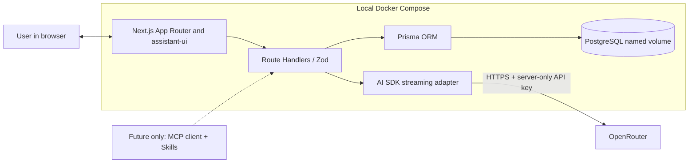
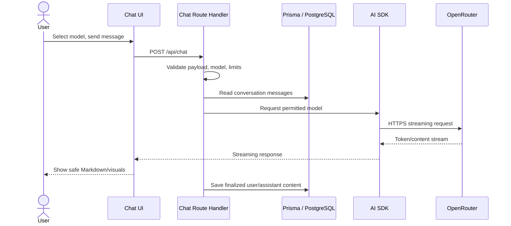

# Architecture — target design for Release 0.1

**Status: MVP target; ONK-001 foundation implemented.** Next.js, database readiness and the local PostgreSQL/Compose foundation exist. The chat, provider and conversation flows below remain planned. See [Local development](development.md) for the current runtime.

## Boundaries

- **Web + backend:** one Next.js App Router application serves the chat UI and server-side Route Handlers, with no separate Node/Express/NestJS process.
- **LLM:** OpenRouter is the only MVP LLM provider. The Vercel AI SDK handles streaming and compatible model requests; the backend only exposes a short allowlist of configured models.
- **UI:** assistant-ui provides chat interaction primitives. Small custom React renderers add code copy, KaTeX mathematics, Mermaid diagrams and Vega-Lite visualizations.
- **Persistence:** Prisma + PostgreSQL store conversations and finalized messages. Docker Compose runs `web` and `db` with a persistent DB volume.
- **Future extensions:** MCP tools and skills are shown as **candidates**; they are **not** part of the MVP data model, tool list or routes.

## MVP flow

Implementation order matters: a failed/cancelled stream must not leave misleading completed assistant messages. Define the transaction and stop/retry semantics when ONK-002 and ONK-004 are implemented, then test the behavior.

## Security and hosting constraints

Release 0.1 is for local, single-user use only. Bind the web port to localhost in Compose. Do not imply that an unauthenticated app is ready for public internet hosting. See [Security](security.md) for untrusted Markdown/Mermaid/Vega specs and API key handling.

## Version compatibility checkpoint

ONK-001 pins the Next.js, React, Prisma, TypeScript and Node.js foundation; see [Local development](development.md). During ONK-002/003, verify and pin compatible AI SDK and assistant-ui versions. Avoid experimental RSC `streamUI` and optional cloud-backed assistant-ui services; **assistant-ui components and the AI SDK run with your own Next.js server**.

## See also

[Chat flow](chat-flow.md) · [API contract](api-contract.md) · [Data model](data-model.md) · [Model configuration](model-configuration.md) · [Extensions (future)](extensions.md).
