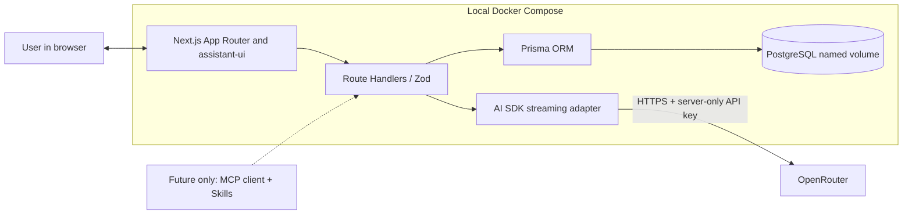
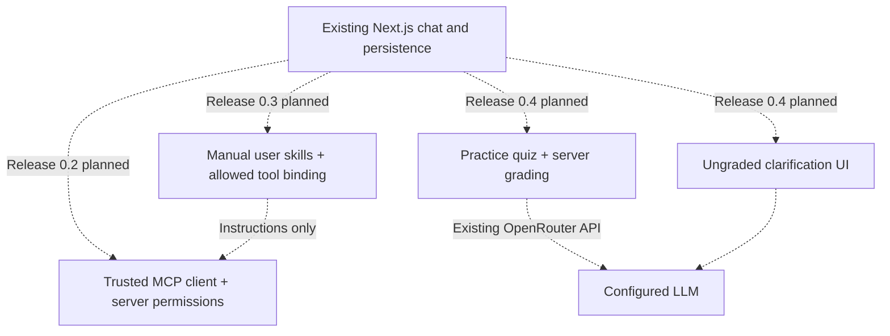

# Architecture — Release 0.1

Next.js serves the UI, OpenRouter streaming and PostgreSQL conversation routes in one application. See [release verification](releases/release-0.1-mvp/verification.md) for observed checks and [local development](development.md) for runtime commands.

## Boundaries

- **Web + backend:** one Next.js App Router application serves the chat UI and server-side Route Handlers, with no separate Node/Express/NestJS process.
- **LLM:** OpenRouter is the only MVP LLM provider. The Vercel AI SDK handles streaming and compatible model requests; the backend only exposes a short allowlist of configured models.
- **UI:** assistant-ui provides chat interaction primitives. Small custom React renderers add code copy, KaTeX mathematics, Mermaid diagrams and Vega-Lite visualizations.
- **Persistence:** Prisma + PostgreSQL store conversations and finalized messages. Docker Compose runs `web` and `db` with a persistent DB volume.
- **Future extensions:** MCP tools, runtime skills and quizzes have **planned story files** for Releases 0.2–0.4; they are **not** part of the implemented 0.1 data model, tool list or routes.



## MVP flow

```mermaid
sequenceDiagram
    actor User
    participant UI as Chat UI
    participant Route as Chat Route Handler
    participant Store as Prisma / PostgreSQL
    participant SDK as AI SDK
    participant Provider as OpenRouter
    User->>UI: Select model, send message
    UI->>Route: POST /api/chat
    Route->>Route: Validate payload, model, limits
    Route->>Store: Compare version, save user and pending answer; read context
    Route->>SDK: Request permitted model
    SDK->>Provider: HTTPS streaming request
    Provider-->>SDK: Token/content stream
    SDK-->>UI: Streaming response
    UI-->>User: Show safe Markdown/visuals
    Route->>Store: Save final assistant content and status
    Route-->>UI: Acknowledge saved completion
```

The server owns conversation context. A short transaction compares the conversation version and reserves a turn before any provider call. No database transaction remains open during generation. A second transaction stores the bounded final text and status before the successful SSE finish. Stop and errors save partial text as stopped/failed. A request lease expires after the generation deadline plus five seconds; opening, changing or deleting that conversation then recovers abandoned pending work as failed. Regenerate replaces the latest assistant row, preserving its ID and sequence. See the [data model](data-model.md).

## Security and hosting constraints

Release 0.1 is for local, single-user use only. Bind the web port to localhost in Compose. Do not imply that an unauthenticated app is ready for public internet hosting. See [Security](security.md) for untrusted Markdown/Mermaid/Vega specs and API key handling.

## Version compatibility checkpoint

ONK-001 pins the Next.js, React, Prisma, TypeScript and Node.js foundation; see [Local development](development.md). The compatible AI SDK and assistant-ui versions are pinned in the lockfile. Avoid experimental RSC `streamUI` and optional cloud-backed assistant-ui services; **assistant-ui components and the AI SDK run with your own Next.js server**.

## See also

[Chat flow](chat-flow.md) · [API contract](api-contract.md) · [Data model](data-model.md) · [Model configuration](model-configuration.md) · [Extensions (future)](extensions.md).

## Planned capabilities, not present in Release 0.1



Brand identity is described in [branding.md](branding.md); the metadata does not alter legal notices. Release 0.4 details are in [quizzes.md](quizzes.md). None of these planned layers has implementation or verification evidence yet.
