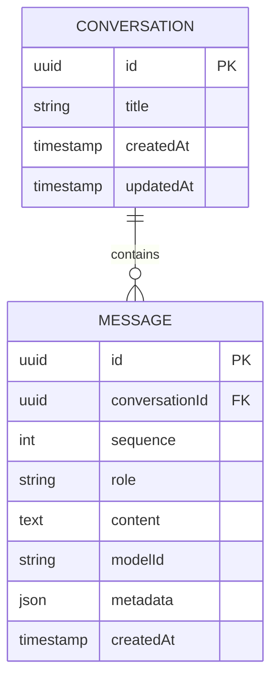

# PostgreSQL / Prisma data model — target

**Status: Planned.** ONK-001 introduces database connectivity and migrations; ONK-004 implements conversation persistence. No Prisma schema or migrations are included in this baseline.

## MVP entities

| Entity | Minimum meaning |
| --- | --- |
| `Conversation` | Identifies a chat and its visible title and timestamps |
| `Message` | Ordered user/assistant content, optional model ID and safe metadata |

- Store messages in deterministic order. Preserve referential integrity and cascading deletes where appropriate.
- Consider storing completed assistant content atomically after generation, not each transient stream token.
- Use Prisma types and a supported PostgreSQL version; JSON/JSONB is fine for **non-secret** optional message metadata.
- Treat tool-call history, integration credentials, user accounts and skill definitions as **future** entities, not part of the baseline schema.
- Do not store the OpenRouter API key or plain credentials in messages, DB JSONB or prompt context.

## Local persistence

The Compose `db` service should mount one named persistent volume. Removing an application container must not delete chat history. Deleting volumes is destructive and requires explicit approval for tests or cleanup.

See [Extensions](extensions.md) for *conceptual* later tables and permission boundaries; they are not migration requirements for Release 0.1.
