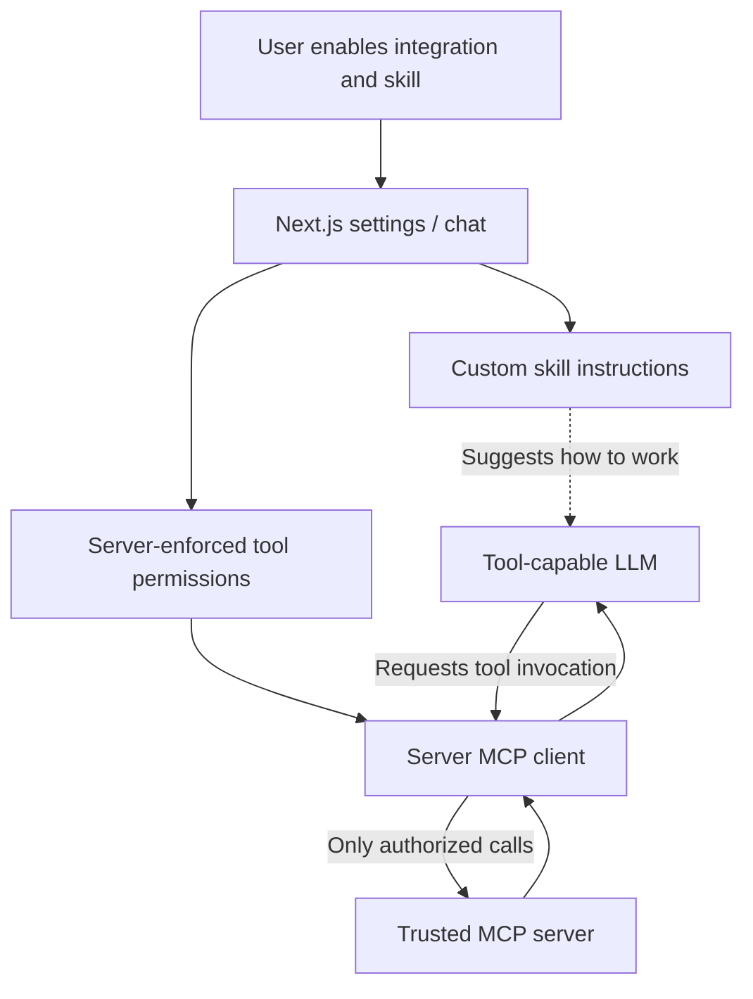

# Later MCP + custom Skills — high-level concept only

**Not included in Release 0.1.** No MCP connection, runtime skill, permission editor or new database table exists in this repository baseline. This document records boundaries for later discussion, not acceptance criteria or implementation authorization.

## Intended behavior

1. A local user enables **one trusted, read-only MCP connection**, initially with a predefined server/transport rather than arbitrary pasted URLs.
2. The app discovers and filters available tools, exposing **only the backend-allowed tools** to a tool-capable OpenRouter model.
3. The user may later create a custom **Skill**: a short set of instructions with optional allowed-tool bindings.
4. The user manually activates a skill for a conversation; its instructions are included without granting any additional authority.
5. The AI may suggest a tool call, but the backend verifies permissions and executes it; later write-capable calls require explicit user approval.

## Clear separation

| Concept | Role | Grants permission? |
| --- | --- | --- |
| MCP connection | Provides available tool descriptions and execution transport | No, not by itself |
| Backend permission set | Defines which tools/actions may actually execute | **Yes, enforced by server** |
| User skill | Suggests how to use permitted tools and format the result | **No** |
| Model tool calling | Selects a permitted tool during an approved interaction | **No** |

Examples such as Penpot depend on a real compatible MCP server, plugins/auth flows and permitted operations. Do not claim Penpot or OAuth compatibility until it has been explicitly implemented and tested.

## Candidate data model (future, not committed)

`Integration`, `Skill`, `SkillIntegration`, `ConversationSkill`, plus optional tool-execution audit records. Only non-secret metadata may go into JSONB. Secrets require encryption or external server-side storage. Real entity names and relationships must be confirmed after the initial MCP experiment.

See [Roadmap](roadmap.md) for provisional ONK-005–008 titles. No actual story files or acceptance criteria exist for these phases.
