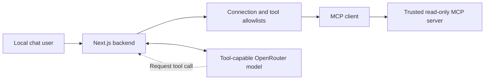

# MCP and Custom Skills — planned architecture

**Planning only:** ONK-005–008 are now defined with acceptance criteria in [Release 0.2](releases/release-0.2-mcp-tool-integration/README.md) and [Release 0.3](releases/release-0.3-custom-skills/README.md). Neither release is implemented. Read only the active story when starting implementation.

## Intended MCP flow

1. The local user enables one explicitly configured, trusted, read-only MCP server. No user-entered arbitrary URL or implicit external access.
2. A server-side client discovers tools and filters them through backend allowlists before exposing names/descriptions to a supported OpenRouter model.
3. A model may request allowed tools; the **backend** validates tool name, arguments, limits and conversation authorization again before execution.
4. UI reports bounded tool invocation results. MCP data is untrusted; no secret or privileged data enters chat logs.

## Intended Skills flow

1. Save user-authored **text-only instructions** as app runtime Skill records, never as executable code.
2. User manually selects a Skill for a conversation; it is not activated automatically or by merely viewing its name.
3. User assigns a subset of already permitted tools to the active Skill; the **intersection** of all server permissions decides what can actually run.
4. Skill text can influence the model's workflow but **cannot** grant access to tools, alter system policies or skip approvals.

| Component | Responsibility | Grants permission? |
| --- | --- | --- |
| MCP connection | Provides tool discovery/execution transport | No |
| Backend policy | Allows destinations, tools and actions | **Yes** |
| Skill | User-supplied guidance for a task | No |
| Model | Suggests a permitted tool based on user input | No |
| Codex `.agents/skills` | Development guidance while coding | Unrelated to runtime |

## Data and verification

The additional `Integration`, `Skill` and association tables are **planned only**. Non-secret metadata can use PostgreSQL JSONB; API keys need server-owned secrets or proper encryption. Treat a successful fake-server test differently from a real, separately approved integration smoke test. No Penpot-specific or arbitrary OAuth compatibility is promised.

See [Security](security.md), [Data model](data-model.md) and the active release stories.
