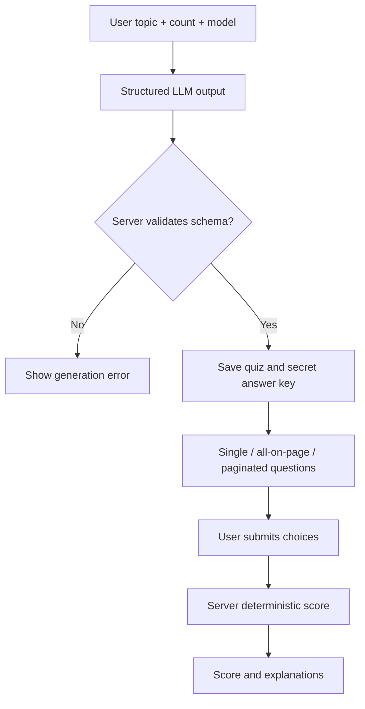

# Interactive quizzes and chat clarifications — planned Release 0.4

**Not implemented.** The accepted design separates **graded practice quizzes** from **ungraded AI clarification questions**; see [Release 0.4](releases/release-0.4-interactive-quizzes/README.md).

## Practice quiz

The user asks for a small practice quiz on a chosen topic and picks one configured OpenRouter model. The server requests a bounded structured response with single-choice/multi-select questions, explanations and an answer key. It verifies schema consistency before storing it. This is **practice**, not a certified assessment; the model may still generate factually wrong answers.

The learner may see one question, several on one page or several across paginated steps. **The correct answers stay server-side until submission**. On submission, the backend deterministically compares the selected option IDs (exact-set match for multi-select), returns count/percentage and shows feedback. No model call is needed for grading.



## Ungraded chat clarification

The assistant may optionally request **one or a small group** of clarifying answers in the same conversation. Each question can use free text, single select or multiple select. User reviews and submits the answers to continue the chat. **No score, answer key or correct/incorrect judgment is created.** A structured question is never permission to invoke an MCP tool or activate a Skill.

```mermaid
sequenceDiagram
    actor User
    participant Chat as OpenNook chat
    participant Server as Next.js backend
    participant LLM as OpenRouter model
    Chat->>Server: User prompt
    Server->>LLM: Prompt / context
    LLM-->>Server: Optional structured clarification questions
    Server-->>Chat: Render ungraded questions
    User->>Chat: Select choices or type answers; confirm
    Chat->>Server: Confirmed answers
    Server->>LLM: Resume with user answers
    LLM-->>Chat: Continue conversation
```

## Boundaries

- Only objective single/multi-choice practice questions receive a score in the initial implementation.
- A free-text clarification response is normal chat input, never graded.
- Validate all model-generated text, question counts, option IDs, answer keys and submissions; use safe Markdown and size limits.
- Persist quiz and clarification state without introducing fake successes or duplicate chat turns.
- Release 0.4 is **not contingent on the user enabling MCP or Skills**; it works with the basic chat/provider architecture.
