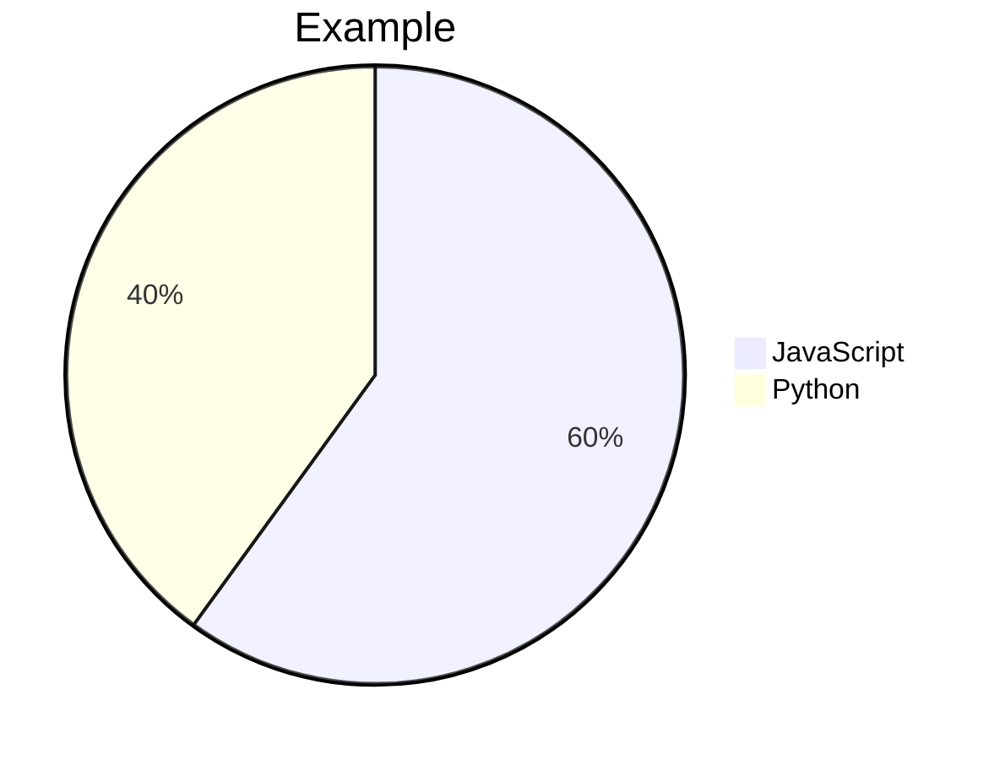

# Chat content rendering — ONK-003

The chat uses assistant-ui primitives with `@ai-sdk/react` and the compatible `@assistant-ui/ai-sdk` runtime. A regular `DefaultChatTransport` sends text-only messages to the ONK-002 API; no cloud storage, frontend tools, attachments, MCP connection or automatic model request is configured. ONK-004 stores conversation text and final statuses in PostgreSQL; loaded answers use the same safe renderers.

## Controls and request limits

Choose one of the configured models, enter a message and use Send (Enter) or insert a line break (Shift+Enter). Stop aborts the active fetch. Regenerate explicitly replaces the most recent answer from the same user prompt. New chat opens an empty thread while keeping earlier conversations in history. Copy message preserves the original text; Copy code copies the fenced source. Clipboard failures leave the text selectable.

Model selection and a second Send are disabled during a request. Errors preserve existing messages and expose only generic guidance. The client validates the same message/context/body limits before sending; it never silently truncates conversation context or selects a fallback model. See [HTTP contracts](api-contract.md) for server-enforced limits.

## Markdown, code and math

- `react-markdown` + GFM, with raw HTML skipped. Images are displayed as an omission label, never fetched. Links require an explicit HTTP(S) or mailto scheme, open only on a user click and omit the referrer/opener.
- Fixed Prism grammars highlight ordinary markup/CSS/JavaScript, TypeScript, JSON, Python, Bash and SQL as React text/token spans. Unknown languages remain plain text. Highlighting is limited to 12,000 characters per block; code is never executed.
- Remark math supports `$...$` inline and `$$` display blocks. A bounded Markdown syntax extension also recognizes `\(...\)` and `\[...\]` before Markdown consumes their backslashes; TeX row breaks such as `\\[2pt]` remain intact. Code spans/fences, indented code and escaped delimiters remain literal. KaTeX uses `trust: false`, `strict: "error"`, `throwOnError: true`, at most 100 macro expansions, `maxSize: 10` and at most 2,000 source characters. Invalid/unsupported math remains readable as source. Fonts and styles are local application assets.
- Rich previews are limited to 32,000 characters per text part; longer messages show a bounded text preview and remain fully available via Copy message. While streaming, code/math/graphic blocks stay inert text. Markdown parser/rendering failures fall back to readable text.

For example, write the following directly in a Markdown answer, outside a code fence:

```text
Inline: $x^2$ or \(x^2\).

$$
\begin{cases}x+y=3\\[2pt]x-y=1\end{cases}
$$

\[
A=\begin{pmatrix}1&2\\[2pt]3&4\end{pmatrix}
\]
```

These are KaTeX expressions, not full LaTeX documents. Do not JSON-escape the backslashes in the final Markdown. KaTeX's [delimiter examples](https://katex.org/docs/autorender) describe the same common conventions; OpenNook parses them within Markdown and does not use DOM auto-rendering.

## Model formatting guidance

The server supplies a fixed [formatting prompt](../src/server/ai/prompt.ts) on every model request, with working math, Mermaid flowchart/pie and Vega-Lite examples. It describes OpenNook's supported subset, fence language names and limits. This guide counts toward the 24,000-character / 32-message server context budget, is not stored as a conversation row and cannot be supplied or replaced through the client API. Loaded messages are rendered directly without another model request.

The guide helps the model produce compatible output; validation, trust restrictions and sanitization remain enforced independently. Actual generation quality across configured models has not been tested with a paid provider request.

## Mermaid

Use a fenced `mermaid` block. Supported diagram families are flowchart/graph, sequence, class, state (`stateDiagram-v2`), entity relationships and pie charts. Diagrams have a 6,000-character, 100-statement and 100-edge budget. Input rejects configuration directives/frontmatter, HTML, click/callback/link/style instructions, image/icon nodes and URL schemes. Mermaid runs only after the response ends, with strict security, root-level `htmlLabels: false` and error rendering suppressed. Generated SVG is sanitized before insertion; no bind/click callbacks run.

Pie charts accept an optional `showData`, one optional title and uniquely quoted labels with positive numeric values (at most two decimal places and at most 1e12). A trailing `%` on every value is accepted as a preview convenience: only those suffixes are removed for Mermaid, while stored text and Copy code retain the original source. Mixed percentage/numeric entries, inline colors/comments after values and malformed/unsafe statements stay as source with a failed-preview status. If percentage values do not total 100, a visible note explains that slices show proportions of their actual total; no data values are rewritten.



Mermaid's [pie syntax](https://mermaid.js.org/syntax/pie.html) expects numeric values without percent suffixes. This is syntax handling, not validation of the model's statistical claims.

## Vega-Lite

Use a fenced `vega-lite` block with a supported inline-data spec:

```json
{
  "mark": "bar",
  "data": { "values": [{ "category": "A", "amount": 3 }, { "category": "B", "amount": 5 }] },
  "encoding": {
    "x": { "field": "category", "type": "nominal" },
    "y": { "field": "amount", "type": "quantitative" }
  }
}
```

Supported marks are `bar`, `line`, `point` and `area`; x/y and optional color use existing fields with quantitative/nominal/ordinal/temporal types and optional titles. Every referenced field must exist in each row, and quantitative values must be finite numbers. Optional chart title, width (160–640) and height (120–400) are bounded. Defaults are 480×260. Data has 1–500 rows, at most 12 fields per row, short scalar strings/numbers/null values and simple safe field names. The whole JSON source is bounded to the rich-preview limit.

The Zod schema rejects unknown properties, including URL/named data, transforms, expressions, parameters, image marks, layers, links, signals and arbitrary config. Vega-Lite compiles the accepted subset. Vega parses expression ASTs and uses `vega-interpreter`, rather than generating JavaScript functions. All loader methods deny access, and the View is finalized after its SVG is produced. The `$schema` identifier, if supplied, must be the fixed v6 URI; it is not fetched. See the official [inline-data examples](https://vega.github.io/vega-lite/docs/data.html#inline) and [specification structure](https://vega.github.io/vega-lite/docs/spec.html); OpenNook intentionally accepts the bounded subset above.

## Graphics failures and sanitization

At most four graphic previews are attempted per text part. DOMPurify's SVG profile strips scripts, foreign objects, images, links and executable/remote attributes; a further SVG pass removes network-bearing styles/resources. Invalid or oversized generated SVG is rejected. Failed previews show a short status and retain the original fenced source, without breaking surrounding text or the composer.

Tests exercise normal and hostile Markdown/math/SVG/chart/diagram input. Browser tests also render actual library graphics, inspect controls and block external requests. Actual outcomes and any limitations are in [release verification](releases/release-0.1-mvp/verification.md).

Implementation references: [assistant-ui AI SDK runtime](https://www.assistant-ui.com/docs/runtimes/ai-sdk/v7), [react-markdown security](https://github.com/remarkjs/react-markdown#security), [KaTeX options](https://katex.org/docs/options), [Mermaid security level](https://mermaid.js.org/config/schema-docs/config-properties-securitylevel.html), [Vega interpreter](https://vega.github.io/vega/usage/interpreter/), [DOMPurify](https://github.com/cure53/DOMPurify).
